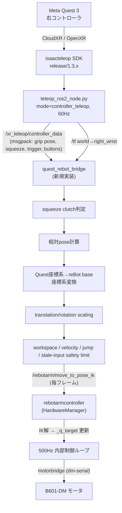

# Architecture

Meta Quest 3 → ROS 2 (Jazzy) → reBot Arm B601-DM (Damiao motor版) の
テレオペレーション設計。2026-09 時点の調査結果と設計方針をまとめる。

## 1. 採用する外部リポジトリと責務

| Repo | 採用対象 | 責務 |
|---|---|---|
| [NVIDIA/IsaacTeleop](https://github.com/NVIDIA/IsaacTeleop) | `release/1.3.x` の `examples/teleop_ros2` を直接ビルド | Quest 3 controller pose/button → ROS 2 topic/TF publish |
| ~~NVIDIA-ISAAC-ROS/isaac_ros_teleop~~ | **不採用** | 中身は IsaacTeleop の `examples/teleop_ros2/python/teleop_ros2_node.py` を ament_cmake でラップしただけ。humanoid(G1) 向け `pose_reset_node` や重い依存が単腕 reBot には不要 |
| [Seeed-Projects/reBotArmController_ROS2](https://github.com/Seeed-Projects/reBotArmController_ROS2) | `main` | B601-DM ROS 2 driver 本体（topic/service/action、URDF、状態機械） |
| [Seeed-Projects/reBotArm_control_py](https://github.com/Seeed-Projects/reBotArm_control_py) | `rebot.repos` で `third_party/reBotArm_control_py` に vcs import（pip installはしない） | Pinocchio IK/FK + `motorbridge` による Damiao 実モータ制御ライブラリ |

### IsaacTeleop のバージョン選定

`main`（最新 1.6.x 系）は `xr_teleop/ee_poses` の型を `geometry_msgs/PoseArray`
から独自 msg `teleop_ros2_interfaces/msg/NamedPoseArray` へ破壊的変更している。
`sim2real-rebot-devarm` で動作確認済みの `isaacteleop[cloudxr]~=1.3.131` wheel は
`release/1.3.x` に対応するため、**`release/1.3.x` を固定採用**する。

なお IsaacTeleop 本体には `docs/source/getting_started/lerobot/rebot.rst` という
reBot 専用ページが存在するが、**B601-RS (RobStride) 専用で B601-DM は対象外**
と明記されている。Damiao 版は本リポジトリで独自に接続する。

## 2. NVIDIA側が publish する ROS 2 topic/message/TF

`examples/teleop_ros2/python/teleop_ros2_node.py`（`release/1.3.x`,
`mode=controller_teleop`, デフォルト `rate_hz=60`）が publish するもの:

| Topic | 型 | 内容 |
|---|---|---|
| `xr_teleop/ee_poses` | `geometry_msgs/PoseArray` | `poses[0]`=左, `poses[1]`=右。**AIM pose**（狙点系） |
| `xr_teleop/controller_data` | `std_msgs/ByteMultiArray`（msgpack dict） | 左右それぞれの grip/aim position・orientation、squeeze_value、trigger_value、primary/secondary/thumbstick_click、menu_click、thumbstick[x,y]、is_active |
| `xr_teleop/head_pose` | `geometry_msgs/PoseStamped` | ヘッドpose（未使用） |
| `xr_teleop/finger_joints` | `sensor_msgs/JointState` | TriHand向け関節角（未使用） |
| `/tf` | `tf2_msgs/TFMessage` | `world → right_wrist` / `left_wrist` / `head` |

補足:

- A/B/X/Y ボタンや thumbstick は独立 topic ではなく `controller_data` の
  msgpack フィールドとして来る（`sensor_msgs/Joy` は不使用）。
- `ByteMultiArray.data` は1バイトずつの特殊エンコーディングのため、
  受信側でのデコード処理が必要。
- 座標系はデフォルトで **OpenXR RUB** (x-right, y-up, z-back) のまま。
  ROS FLU への変換は `transform_rotation` パラメータ
  （クォータニオン `[0.5, -0.5, -0.5, 0.5]`）で可能。

**設計判断**: 既存の動作確認済み smoke test (`isaacteleop` SDK 直呼び出し) は
GRIP pose を使っている。`xr_teleop/ee_poses` は AIM pose のため、
`quest_rebot_bridge` は `ee_poses` ではなく `controller_data` 内の
**grip_position / grip_orientation** を使い、既検証の挙動と一致させる。

## 3. reBot側が提供する ROS 2 topic/service/action

`rebotarmcontroller`（namespace デフォルト `/rebotarm`）:

- **pub** `joint_states` (`sensor_msgs/JointState`, デフォルト約100Hz, `joint_state_rate` パラメータで可変)
- **pub** `arm_status` (`rebotarm_msgs/msg/ArmStatus`, QoS `TRANSIENT_LOCAL` latched)
  フィールド: `header, mode, enabled, control_loop_active, state_machine, joint_names, per_joint_status_code, error_codes`
- **sub** `joints/{name}/cmd/pos_vel` (`rebotarm_msgs/msg/JointPosVelCmd{pos, vlim, stamp}`)
- **sub** `joints/{name}/cmd/mit` (`rebotarm_msgs/msg/JointMitCmd{pos, vel, kp, kd, tau, stamp}`)
- **service `move_to_pose_ik`** (`rebotarm_msgs/srv/MoveToPoseIK`)
  - req: `geometry_msgs/Pose target_pose`
  - res: `bool success`, `string message`, `float64[] q_solution`
  - **非ブロッキング**: IK を解いて内部 target を即座に更新するのみ（スレッド生成・待機なし）。
    既に稼働中の内部制御ループ（後述）が継続送信するため、**毎フレーム呼び出しても安全**
    （拒否されるのは状態機械が `SAFE_HOMING` / `TRAJ_RUNNING` の時のみ）
- **action** `move_to_pose` (`rebotarm_msgs/action/MoveToPose`) — **ブロッキング/プランニング系**。
  呼び出しごとに duration 付き軌道計画スレッドを生成し完了まで待機する設計。**毎フレーム呼び出し不可**
- **action** `follow_joint_trajectory` (`control_msgs/action/FollowJointTrajectory`) — 標準
- **action** `gripper/command` (`control_msgs/action/GripperCommand`)
  + **service** `gripper/open` / `gripper/close` (`rebotarm_msgs/srv/GripperCommand{position, timeout → success, reached_position, message}`) / `gripper/set` (`SetGripper`)
- **service** `enable` / `disable` / `safe_home` (`std_srvs/Trigger`)
- **service** `set_zero` (`rebotarm_msgs/srv/SetZero`)
- 状態機械: `IDLE / TRAJ_RUNNING / LOWLEVEL_STREAMING / GRAVITY_COMP / SAFE_HOMING`

### B601-DM 対応

`rebotarm_hardware.yaml` で `default_model: dm`, `channel: /dev/ttyACM0`,
`rate: 500`(内部制御ループHz), `urdf_path: urdf/DM/urdf/ReBot_Arm_DM.urdf` が
明示的に設定されている。

**要確認事項（M3で確認）**: `bringup.launch.py` の URDF 選択ロジックは
`rs` とそれ以外の2分岐のみで、グリッパー付き URDF
(`description/urdf/reBot_B601_DM_with_gripper.urdf`) が実際に使われているかは
未確認。RViz で目視確認する。

### アーキテクチャ

`rebotarmcontroller` 自体は MoveIt2 / ros2_control に依存しない素の `rclpy`
ノードで、Pinocchio IK を `reBotArm_control_py` から直接呼び出す。
`rebotarm_moveit_config` は RViz 動作計画デモ用の別パッケージで、
`moveit_servo` への依存はどこにも存在しない（= 既存の servo 系 interface は
`move_to_pose_ik` 一択）。

### 実機非接続での dry-run について（既知の制約）

`rebotarmcontroller` は node 構築時に `HardwareManager.connect()` を
無条件に呼び出しており、`channel` に設定されたシリアルポートへの接続に
失敗すると例外を re-raise して node construction ごと落ちる。DM 用の
fake driver は存在しない（RS 用の `FakeRsDriver` はあるが DM 非対応）。

→ **M3 では `rebotarmcontroller` 自体は起動せず、`robot_state_publisher` +
`joint_state_publisher_gui` のみで URDF/TF を確認する**方針とした
（IK / `move_to_pose_ik` の動作確認は M4 以降、実機接続かつ許可を得てから行う）。

## 4. データフロー



## 5. 自作が必要な部分と既存コードを使う部分

| 部分 | 方針 |
|---|---|
| Quest → ROS 2 (CloudXR/OpenXR/msg publish) | 自作しない。IsaacTeleop `examples/teleop_ros2` (release/1.3.x) をそのままビルド |
| reBot driver / IK / motor control | 自作しない。`reBotArmController_ROS2` + `reBotArm_control_py` をそのまま使用 |
| **`quest_rebot_bridge`** | **新規実装**（唯一）: clutch, 相対pose計算, 座標変換, scaling, safety limit, `move_to_pose_ik` 呼び出し |

## 6. 連続 Cartesian teleoperation に最適な interface の選定

**`move_to_pose_ik` サービスを採用する。**

根拠（ソースコード確認済み）:

- `move_to_pose_ik` は IK を解いて内部 target (`_q_target`) を書き換えるだけで、
  スレッド生成もブロッキングもしない。既に常時稼働している内部制御ループ
  （500Hz）が target を継続送信するため、**毎フレーム呼んでも滑らかに追従**する。
- 一方 `move_to_pose` action と `follow_joint_trajectory` action は、
  呼び出すたびに `duration` 付きの軌道計画スレッドを生成し、完了まで
  ブロッキング待機する設計。毎フレーム呼ぶと生成・停止が衝突し、
  レイテンシとカクつきの原因になる（「単発 motion planning の毎フレーム
  呼び出し」問題そのもの）。
- 既存の `MoveToPoseIK.srv` をそのまま使えるため、reBot 側への追加実装は不要。

## 7. GX10 (ARM64) / Ubuntu 24.04 / ROS 2 Jazzy 互換性

- IsaacTeleop `examples/teleop_ros2/Dockerfile` は `ROS_DISTRO=jazzy`,
  `PYTHON_VERSION=3.12`, `TARGETARCH=arm64` 分岐（nlopt ソースビルド）を
  明記している。ただしデフォルトの `controller_teleop` モードは
  nlopt/dexpilot（ヒューマノイド手向け retargeter）を必要としないため、
  この分岐は今回関係ない。
- `reBotArmController_ROS2` の `package.xml` には配布ディストロ指定タグが
  存在せず、README記載（Humble/Jazzy対応）はコード上未検証。依存関係自体は
  ディストロ非依存なので Jazzy でも動作する見込み。
- **要注意**: `reBotArm_control_py/pyproject.toml` は
  `requires-python = ">=3.10,<3.12"` で Python 3.12 を除外宣言しているが、
  実際の依存（`pin`=Pinocchio, `motorbridge`）は cp312 aarch64 wheel が存在し、
  このGX10上で実地動作確認済み（`sim2real-rebot-devarm` の smoke test）。
  ただし `pip install -e .` はパッケージング不備（flat-layout エラー）で
  失敗するため、pip install はしない。

### reBotArm_control_py の配置場所（M0で確定した事実）

`reBotArmController_ROS2` の実装（`hardware_config.py`）は、Pythonパッケージ
解決を **決め打ちの相対パス**で行っている:

- `_ensure_rebot_sdk_in_syspath()` が `third_party/reBotArm_control_py`
  ディレクトリ（内部に `reBotArm_control_py/` パッケージ本体を含む）を要求し、
  `sys.path.insert(0, ...)` する。
- `_workspace_root()` は `hardware_config.py` 自身の実行時パスから親ディレクトリを
  順に遡り、`third_party/reBotArm_control_py` を含む最初の祖先ディレクトリを探す。
- したがって **`colcon build --symlink-install` が必須**（コピーインストールだと
  `install/` 配下にコピーされたファイルの祖先を遡っても `third_party/` が
  見つからない）。
- 配置先は `ros2_ws/src/external/reBotArmController_ROS2` の直下
  （リポジトリチェックアウトの兄弟ディレクトリ）である必要がある
  （`hardware_config.py:33-38, 41-52` で確認済み）。

`reBotArmController_ROS2` 自身の README / エラーメッセージは
`https://github.com/vectorBH6/reBotArm_control_py.git` のフォークをクローンする
よう指示しているが、**実際に両者を diff した結果 Seeed-Projects/reBotArm_control_py
(main) の方が新しい**（IK/joint limits修正のPR #29、`gravity_compensation.py`
controllerがフォーク側に無い、など）。そのため本リポジトリでは
**Seeed-Projects の canonical repo を採用**し、`rebot.repos` で直接
`third_party/reBotArm_control_py` に vcs import する（git submoduleは使わない。
理由: `ros2_ws/src/external/` 配下は vcstool 管理下で `.gitignore` 対象のため、
その内部にさらに独立した submodule を持たせても本リポジトリの git 履歴には
反映されず、`rebot.repos` に一本化した方が再現性が高いため）。

## 8. リポジトリ構成

```
rebot/
├── README.md
├── docs/architecture.md
├── ros2_ws/
│   ├── rebot.repos              # vcstool: IsaacTeleop, reBotArmController_ROS2, reBotArm_control_py
│   └── src/
│       ├── quest_rebot_bridge/  # 新規実装（唯一の自作ROS2パッケージ）
│       └── external/            # vcs import で取得、.gitignore対象
│           ├── IsaacTeleop/
│           └── reBotArmController_ROS2/
│               └── third_party/reBotArm_control_py/
└── tools/
    └── xr_pose_smoke_test.py    # sim2real-rebot-devarmから移植した独立ツール（ROS2化しない）
```

`ros2_ws/src/external/`（`rebot.repos` で vcs import される3リポジトリすべて）
は `.gitignore` で除外し、git には含めない。

## 9. Milestone 計画

- **M0**: ROS 2 Jazzy install、`vcs import < rebot.repos`（3リポジトリ）、
  `colcon build --symlink-install`、Python 3.12 / aarch64 の実地検証
- **M1**: `teleop_ros2_node.py` 単体起動 →
  `ros2 topic echo /xr_teleop/controller_data`、
  `ros2 run tf2_ros tf2_echo world right_wrist` で右コントローラの
  pose/squeeze を確認（reBot は未起動）
- **M2**: `quest_rebot_bridge` 実装（clutch → 相対pose → 座標変換 →
  safety limit）。自前 topic に publish し `ros2 topic echo` / RViz で
  確認（**`move_to_pose_ik` はまだ呼ばない**）
- **M3**: `robot_state_publisher` + `joint_state_publisher_gui` のみで
  URDF/TF を確認（`rebotarmcontroller` 本体・実機接続なし）
- **M4**: Quest 抜きで固定小 target pose を `move_to_pose_ik` に直接送り、
  実機小規模動作を検証（safety limit 実地確認）— **要ユーザー許可**
- **M5**: Quest 接続、低速・小スケール・clutch 必須の片腕テレオペ初回 —
  **要ユーザー許可**

M4 に到達し、ユーザーが明示的に許可するまでは `move_to_pose_ik` を含む
実機動作系の call を一切行わない。

## 10. 実機接続前の安全条件（設計方針）

`quest_rebot_bridge` の safety limit として以下を実装する
（M2 でプレースホルダ値を実装、M4/M5 前に実機ワークスペースに合わせて調整）:

- joint limits: reBot 側 URDF / IK ソルバのハード制約に委譲（`reBotArm_control_py`
  の `_clamp_config()` が IK 解を `model.lowerPositionLimit`/`upperPositionLimit`
  に常時クランプ済み）
- workspace limits: `quest_rebot_bridge` 側で base_link 系のバウンディングボックスを設定
- max translation step / max rotation step: 1フレームあたりの target pose 変化量を制限
- max velocity: 上記 step 制限を `dt` で除した速度としても制限
- stale input timeout: `controller_data` の受信が一定時間途絶えたら clutch 強制解除
- tracking loss 時停止: `is_active` フラグ喪失で即座に clutch 強制解除
- IK failure 時停止: `move_to_pose_ik` の `success=false` 応答時は target を更新しない
  （reBot側の関節はその場保持）
- clutch OFF 時停止: squeeze が閾値未満になった瞬間、target 更新を停止し
  アームは最後の target を保持
